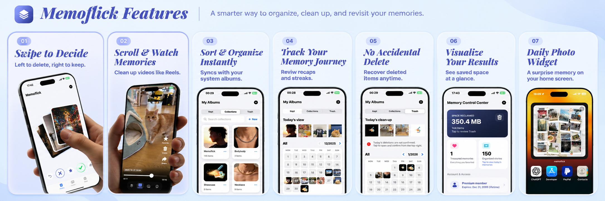

# Memoflick for iOS / Memoflick iOS 版

  

  <strong>A local-first way to revisit, review, and organize your memories.</strong> 
  以本地优先的方式，重温、整理和保存你的回忆。

  
  
  

## Overview / 项目概览

**English**

Memoflick is an offline-first photo and video review app for iPhone. It helps
you turn an overflowing camera roll into a calmer, more intentional memory
library with quick review, favorites, collections, trash recovery, and a
home-screen photo-wall widget.

**中文**

Memoflick 是一款面向 iPhone 的离线优先照片与视频整理应用。它通过快速回顾、收藏、分类、垃圾箱恢复和桌面照片墙小组件，帮助你把不断增长的相册整理成更清晰、更有意识的回忆库。

The core workflow is designed to stay on-device. Memoflick does not require a
Memoflick account, application server, Supabase, subscription, or StoreKit.
Apple Photos may retrieve iCloud-backed originals when requested by the system;
that is handled by Apple Photos and is not an upload to a Memoflick server. See
[`PRIVACY.md`](PRIVACY.md).

核心流程以设备本地为中心。Memoflick 不需要 Memoflick 账号、应用服务器、Supabase、订阅或 StoreKit。若素材由 iCloud Photos 管理，Apple Photos 可能按系统请求取回云端原图；这由 Apple Photos 处理，不是上传到 Memoflick 服务器。详见 [`PRIVACY.md`](PRIVACY.md)。

## Core features / 核心功能

  

Core feature overview / 核心功能总览

| # | English | 中文 |
| --- | --- | --- |
| 01 | Swipe to decide: left to delete, right to keep | 滑动决定：左滑删除，右滑保留 |
| 02 | Scroll and watch memories, including videos | 滚动回顾照片与视频记忆 |
| 03 | Sort and organize media into collections | 将媒体整理到相册与分类中 |
| 04 | Track your memory journey with recaps and streaks | 通过回顾和连续记录追踪整理过程 |
| 05 | Recover items from the trash before permanent deletion | 在永久删除前从垃圾箱恢复项目 |
| 06 | Visualize saved space and organized results | 直观看到释放的空间与整理结果 |
| 07 | Surface a daily memory with the home-screen widget | 用桌面小组件每天展示一段回忆 |

> The image above is the product overview for the repository home page. The
> step-by-step operation screenshots remain intentionally blank in
> [`USAGE.md`](USAGE.md) so they can be replaced with privacy-safe captures of
> the final UI.
>
> 上图是本仓库首页使用的产品功能总览图。操作教程中的步骤截图仍然有意留空，等最终界面确定后再替换为不含隐私信息的真实截图，详见 [`USAGE.md`](USAGE.md)。

## Why Memoflick / 为什么选择 Memoflick

<table>
  <tr>
    <td width="33%"><strong>Local-first 本地优先</strong>  Review media and metadata on-device. 在设备本地完成回顾和整理。</td>
    <td width="33%"><strong>Focused workflow 专注整理</strong>  Make a quick keep, favorite, or trash decision. 快速完成保留、收藏或删除决定。</td>
    <td width="33%"><strong>Memory-friendly 回忆导向</strong>  Turn saved items into collections and daily recaps. 把珍藏内容变成分类和每日回顾。</td>
  </tr>
</table>

## Get started / 快速开始

The full bilingual walkthrough is in [`USAGE.md`](USAGE.md). In brief:

完整的中英文操作教程请查看 [`USAGE.md`](USAGE.md)。快速步骤如下：

1. Open `memoflick/memoflick.xcodeproj` in Xcode / 使用 Xcode 打开工程。
2. Choose the `memoflick` scheme and configure your own Team and Bundle ID / 选择 scheme，并配置自己的 Team 和 Bundle ID。
3. Run on an iPhone or simulator, then grant Photos access / 在 iPhone 或模拟器上运行，并授予照片权限。
4. Review, keep, favorite, categorize, or move items to trash / 开始回顾、保留、收藏、分类或移入垃圾箱。

## Build locally / 本地构建

1. Open `memoflick/memoflick.xcodeproj` in Xcode.
2. Select the `memoflick` scheme and an iPhone simulator or device.
3. For a fork, set your own Apple Developer Team, bundle identifiers, and App
   Group identifiers. The project uses the public placeholder
   `com.example.memoflick.app`; do not reuse Memoflick's publishing identifiers.
4. The project deployment target is iOS 16.6, but normal use requires iOS 17.0
   or later because the app shows an availability message below iOS 17.

使用 Xcode 打开 `memoflick/memoflick.xcodeproj`，选择 `memoflick` scheme 和 iPhone 模拟器或真机。创建 fork 时，请配置自己的 Apple Developer Team、Bundle ID 和 App Group ID；项目中的 `com.example.memoflick.app` 只是公开占位符，不要复用 Memoflick 的发布标识。工程部署目标为 iOS 16.6，但正常使用需要 iOS 17.0 或更高版本。

This repository is unsigned and is not an installable IPA. Signing,
provisioning, and App Store distribution are the responsibility of each fork
owner.

本仓库不包含签名，也不是可直接安装的 IPA。签名、Provisioning Profile 和 App Store 发布由各 fork 维护者负责。

## Privacy / 隐私

The source is intended to keep user media and review metadata on-device. Any
fork that adds networking, analytics, cloud sync, accounts, or remote
processing must update [`PRIVACY.md`](PRIVACY.md) and perform its own privacy
and security review.

本项目旨在让用户媒体和整理元数据留在设备上。任何增加网络、分析、云同步、账号或远程处理的 fork，都必须更新 [`PRIVACY.md`](PRIVACY.md)，并自行完成隐私与安全评估。

## License / 许可证

The source code is available under the PolyForm Noncommercial License 1.0.0.
The authoritative legal text is [`LICENSE`](LICENSE); it permits noncommercial
use only. The Memoflick name, logo, icon, screenshots, and other brand assets
are not automatically licensed for reuse. See [`NOTICE.md`](NOTICE.md),
[`TRADEMARKS.md`](TRADEMARKS.md), and [`THIRD_PARTY_NOTICES.md`](THIRD_PARTY_NOTICES.md).

源代码采用 PolyForm Noncommercial License 1.0.0。具有法律效力的许可证原文请以 [`LICENSE`](LICENSE) 为准，仅允许非商业使用。Memoflick 名称、Logo、图标、截图及其他品牌资源不自动授予复用权。请同时阅读 [`NOTICE.md`](NOTICE.md)、[`TRADEMARKS.md`](TRADEMARKS.md) 和 [`THIRD_PARTY_NOTICES.md`](THIRD_PARTY_NOTICES.md)。

This is source-available software with a noncommercial restriction; it is not
an OSI-approved open-source license.

这是带有非商业限制的 source-available 软件，不是 OSI 认证的标准开源许可证。

## Contributing / 参与贡献

Read [`CONTRIBUTING.md`](CONTRIBUTING.md) and [`CODE_OF_CONDUCT.md`](CODE_OF_CONDUCT.md)
before opening an issue or pull request. Do not commit signing material,
private user data, or service credentials.

提交 Issue 或 Pull Request 前，请阅读 [`CONTRIBUTING.md`](CONTRIBUTING.md) 和 [`CODE_OF_CONDUCT.md`](CODE_OF_CONDUCT.md)。不要提交签名材料、私人用户数据或服务凭据。
